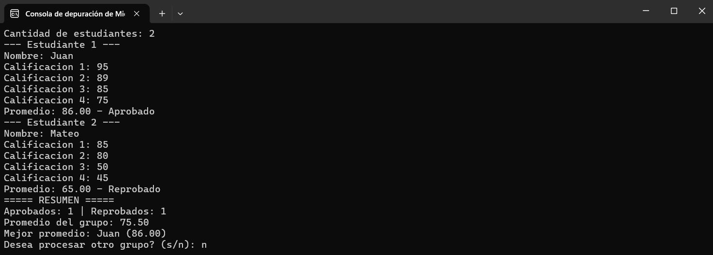

# Sistema de control de calificaciones

**Estudiante:** Ronaldy Santana
**Matrícula:** 2026-1774
**Asignatura:** Lógica de Programación
**Profesor:** Gamalier Reyes del Carmen

## Descripción del programa

Programa de consola en C++ para el centro educativo "La Nueva Escuela". Permite registrar las calificaciones de un grupo de estudiantes, calcular el promedio de cada uno, indicar si está aprobado o reprobado y mostrar un resumen del grupo. Al final pregunta si se desea procesar otro grupo.

## Datos de entrada

- Cantidad de estudiantes del grupo (mayor que 0).
- Nombre de cada estudiante.
- 4 calificaciones por estudiante (entre 0 y 100).
- Respuesta s/n para procesar otro grupo.

## Proceso

1. Se pide la cantidad de estudiantes y se repite la pregunta si el valor no es válido.
2. Por cada estudiante se pide el nombre y las 4 calificaciones. Si una calificación está fuera de rango, se vuelve a pedir.
3. Se acumulan las notas y se calcula el promedio (suma de notas / 4).
4. Si el promedio es 70 o más se cuenta como aprobado; si no, como reprobado.
5. Se acumulan los promedios para sacar el promedio del grupo y se guarda el nombre del estudiante con el promedio más alto.
6. Al final se muestra el resumen y se pregunta si se procesa otro grupo.

## Salida

- Promedio de cada estudiante con dos decimales y su estado (Aprobado o Reprobado).
- Resumen del grupo: cantidad de aprobados y reprobados, promedio general y nombre con el mejor promedio.

## Captura de pantalla

## Bucles utilizados

- **do-while (repetir el programa):** envuelve todo el programa. Se usa do-while porque el programa debe ejecutarse al menos una vez y luego repetirse si el usuario responde "s".
- **do-while (validar cantidad de estudiantes):** se usa para pedir el dato al menos una vez y volver a pedirlo mientras sea menor o igual que 0.
- **for (estudiantes):** recorre cada estudiante del grupo. Se usa for porque ya se sabe cuántas veces se va a repetir (la cantidad de estudiantes).
- **for (calificaciones):** recorre las 4 calificaciones de cada estudiante. Es un for porque siempre son 4.
- **do-while (validar calificación):** pide la nota y la repite mientras esté fuera del rango de 0 a 100.

Además se usaron contadores (`aprobados`, `reprobados`) y acumuladores (`sumaNotas`, `sumaPromedios`).
